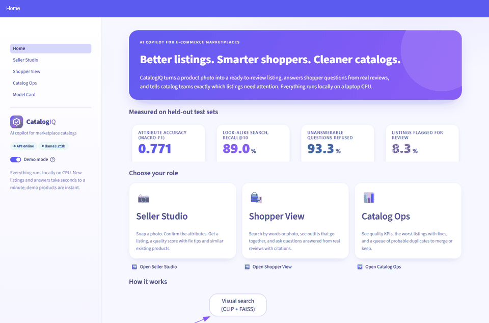
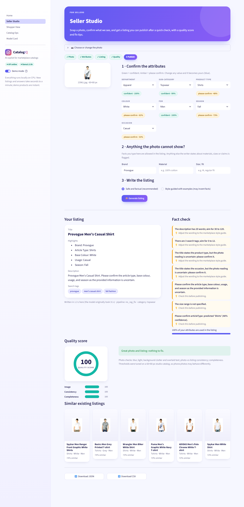
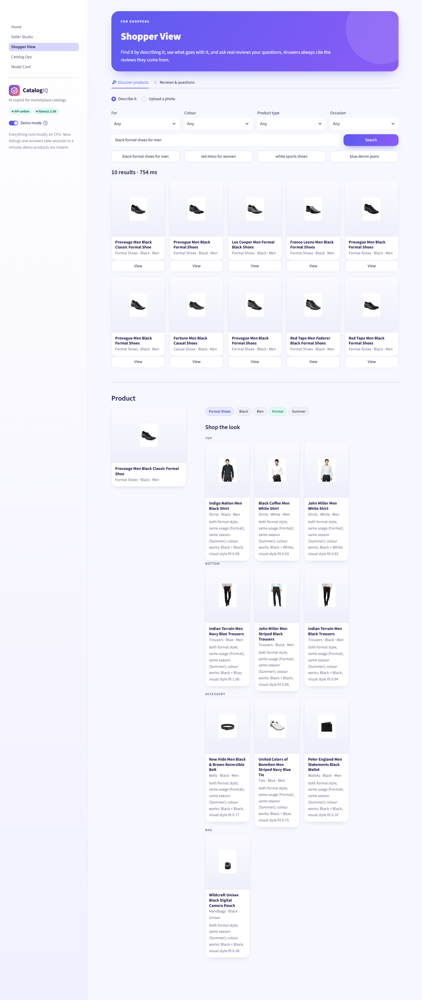
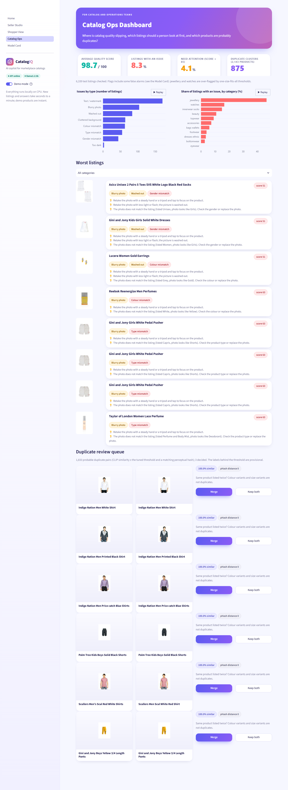
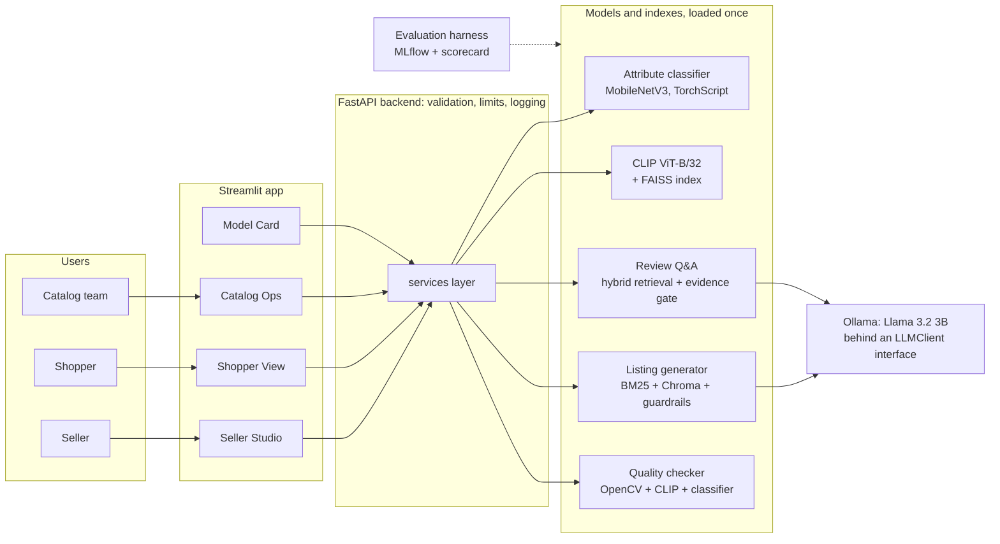

# CatalogIQ

[](https://github.com/nivitsm2011/catalogiq/actions/workflows/ci.yml)

**An AI copilot for online marketplaces: it turns a seller's phone photo into a checked, grounded product listing, answers shoppers' questions from real reviews with citations, and tells the catalog team which listings need attention. It runs fully on a laptop CPU, with a local language model.**



*A slideshow of the real app screens (top of each page). A narrated screen recording script is in [docs/demo_script.md](docs/demo_script.md).*

## The problem

Small sellers upload products with poor photos, wrong categories, missing attributes and weak descriptions. That hurts search, conversion and returns.
Shoppers cannot get a quick answer about fit or quality, and catalog teams cannot see where the quality problems are.
CatalogIQ is a portfolio project that builds the three sides of that problem end to end, and measures what works and what does not.

| User | What they get |
|---|---|
| **Seller** | Upload a photo, get the product's attributes, a title, 5 bullets, a description and search tags, a fact check of the copy, and a 0-100 quality score with plain-English fixes |
| **Shopper** | Search by words or by photo, an outfit ("shop the look"), and answers about fit and quality that cite real reviews or say there is not enough evidence |
| **Catalog / ops team** | Quality KPIs, the worst listings with suggested fixes, and a review queue for suspected duplicates |

## Screens

| Seller Studio | Shopper View | Catalog Ops |
|---|---|---|
|  |  |  |

More: [home](docs/screenshots/01_home.png), [handbag listing](docs/screenshots/03_seller_studio_handbag.png), [review Q&A](docs/screenshots/05_shopper_reviews_qa.png), [model card page](docs/screenshots/07_model_card.png).

## Features

1. **Snap-to-Listing:** my own trained classifier (MobileNetV3-Large, 7 outputs) predicts masterCategory, subCategory, articleType, baseColour, gender, season and usage, with a calibrated confidence. Low-confidence values are shown as "please confirm", not guessed.
2. **Grounded listing copy (RAG):** retrieves similar well-rated listings and the category style guide, then a local LLM (Llama 3.2 3B through Ollama) writes the copy. Deterministic guardrails check every listing for facts that were not given and rewrite it once if needed.
3. **Visual search:** CLIP embeddings and a FAISS index for similar products, "shop the look" with explicit pairing rules, and duplicate detection.
4. **Shopper Q&A over reviews (RAG):** hybrid BM25 + vector retrieval limited to the product on screen, an evidence gate, and answers that cite review ids. With too little evidence it refuses.
5. **Catalog-quality checker:** blur, exposure, resolution, aspect ratio, background and text checks (OpenCV and CLIP), a photo-versus-listing mismatch check, completeness, and one score with fixes.
6. **API and app:** a FastAPI backend with validation, rate limits and friendly errors, and a four-page Streamlit app with a demo mode.

## Results

Every number below is copied from [reports/scorecard.md](reports/scorecard.md), which is produced by one command (`python -m catalogiq.eval.run_all`) that re-runs each evaluation on a fixed test set and logs to MLflow. The scorecard also holds the full tables, a drift check against earlier phases (68 of 75 numbers match, 5 are timings, 2 are flagged timing drift) and the limitations.

| Component | Test set | Result |
|---|---|---|
| **Attribute classifier** | 6,339 held-out photos | Mean macro-F1 **0.771** over 7 attributes (always guessing the majority class: 0.094; frozen features + logistic regression: 0.725; zero-shot CLIP: 0.569). Product type 0.806 macro-F1 / 0.857 accuracy. Colour is weak (0.582 macro-F1, 67.5% accuracy). 13.9 ms per photo on CPU. |
| **Visual search** | 1,995 photo queries, 35,918-photo gallery | CLIP Recall@10 **0.890** (fine-tuned classifier features 0.854, frozen ImageNet features 0.796, random 0.088). Text-to-image Recall@10 0.887. |
| **Duplicate detection** | 100 labelled pairs | Precision 1.00, recall 0.22 at threshold 0.975. **Labels are provisional (assigned by the AI assistant) and positives are few: recall is effectively unknown.** |
| **Listing generator** | 50 held-out products | Share of listings containing an unsupported fact: **70.0% with retrieved examples (RAG), 2.0% without, 0.0% without plus the guardrail rewrite** (40.0% with RAG plus rewrite). RAG also took 44 s per listing against 13 s. |
| **Review Q&A** | 60 questions on 20 products | Hybrid retrieval Recall@5 **1.000** (vector only 0.889), MRR 0.893. Correct refusal of unanswerable questions 93.3%, but **31.1% of answerable questions were also refused**. 100% of cited review ids exist; 84.8% of citations contain the answer. Faithfulness: 40.6% by an LLM judge (a lower bound, the judge is too strict) and 93.3% in the owner's hand-check of 15 answers. |
| **Quality checker** | 500 clean + 8,500 degraded photos; 300 injected mismatches | Defect detection (recall / precision): blurry 0.999 / 0.423, too dark 1.000 / 0.899, bad aspect ratio 1.000 / 1.000, overexposed 0.115 recall only. Mismatch detection overall precision 0.472, recall 0.477 (precision is a lower bound). On all 6,339 test listings 8.3% carry a flag and 4.1% score below 85. |
| **System (CPU)** | 5 photos per pipeline, uncached LLM | Photo to full listing: **15.5 s** mean without RAG (p95 22.2 s), **66.4 s** with RAG and rewrite. Peak RAM 5.1 GB of 16.8 GB. Project folder 4.75 GB (plus 2.0 GB for the language model, stored by Ollama). |

**What I would not claim:** the scorecard's product-impact section uses placeholder assumptions and labels every derived figure ILLUSTRATIVE; nothing here estimates returns, conversion or revenue (that needs an A/B test on a real marketplace). The photos are 60x80 studio thumbnails, so results say little about phone photos. Test sets are small and the evaluation was designed and run by the same AI assistant that built the system. See [Limitations](#limitations).

## Architecture



Data flow per feature, and why each technology was chosen over its alternatives: [docs/architecture.md](docs/architecture.md).

## Tech stack

| Area | Used |
|---|---|
| Vision | PyTorch, torchvision MobileNetV3-Large (own fine-tuning, temperature-scaled confidences), Grad-CAM, TorchScript export |
| Embeddings and search | OpenCLIP ViT-B/32 (LAION-2B), FAISS (exact inner-product index, HNSW option), perceptual hashes (imagehash) |
| RAG | ChromaDB, in-house BM25, reciprocal-rank fusion, sentence-transformers MiniLM, Pydantic structured outputs |
| LLM | Ollama with Llama 3.2 3B (CPU), disk-cached replies, swappable `LLMClient` interface |
| Image checks | OpenCV (Laplacian blur, luminance, corner clutter), CLIP zero-shot for text and watermarks |
| Serving | FastAPI, Uvicorn, Streamlit, Plotly, Lottie |
| MLOps | MLflow (local file store), pytest + pytest-cov (222 tests), ruff, black, GitHub Actions, Docker Compose |
| Data | pandas, pyarrow, scikit-learn |

## How to run

**Prerequisites:** Windows 11 with PowerShell, [uv](https://docs.astral.sh/uv/), [Ollama](https://ollama.com/), about 10 GB of free disk. Nothing needs a GPU. (macOS and Linux: a `Makefile` mirrors `tasks.ps1`.)

### 1. Check out, install, test (about 2 GB of Python packages; checked from a fresh clone: setup 2 minutes with a warm package cache, tests 2-3 minutes)

```powershell
git clone https://github.com/nivitsm2011/catalogiq.git
cd catalogiq
.\tasks.ps1 setup      # creates .venv (Python 3.11), installs the pinned requirements and the package
.\tasks.ps1 test       # 222 tests with fixtures and mocked models: needs no data, no models, no Ollama
.\tasks.ps1 lint       # ruff + black --check
```

### 2. Build the data and models (hours of CPU; data and weights are not in git)

The app needs the Kaggle fashion photos (593 MB), a sample of Amazon reviews (streamed, about 18 MB), a trained classifier (about 42 minutes), CLIP embeddings of the catalog (about 2 hours) and the retrieval indexes. Run the steps in order from [docs/reproduce.md](docs/reproduce.md), then pull the language model once:

```powershell
ollama pull llama3.2:3b      # about 2 GB
```

### 3. Start the API and the app

```powershell
.\tasks.ps1 api      # http://127.0.0.1:8000/docs  (models load in 1-2 minutes; it lists any missing file and how to create it)
.\tasks.ps1 app      # http://localhost:8501
```

Turn on **Demo mode** in the sidebar to use 10 preloaded products. Their listings and sample review answers come from a reply cache and are instant; anything new runs the local model (about 15-40 s).

### Docker (written, not yet built)

```powershell
docker compose build
docker compose --profile setup run --rm ollama-pull   # one time, about 2 GB
docker compose up
```

**Read [docs/docker.md](docs/docker.md) first:** the files have not been built or run (Docker is not installed on the development laptop), image sizes are estimates, and the data and models are mounted from your disk, not baked into the images.

## Project structure

```text
catalogiq/
├── src/catalogiq/        package: data, vision, search, rag, quality, llm, eval
├── api/                  FastAPI backend (routes, services, schemas, limits, startup checks)
├── app/                  Streamlit app: Home.py and four pages
├── configs/              YAML settings and prompts (nothing is hard-coded)
├── notebooks/            six narrated notebooks, one per phase
├── scripts/              build, train, evaluate and tooling scripts
├── tests/                222 tests, tiny fixtures in tests/fixtures
├── docs/                 architecture, model cards, decisions log, progress, API, Docker, interview prep
├── reports/              scorecard.md, figures, per-phase results
├── docker/, docker-compose.yml
├── data/, models/        gitignored: raw and processed data, trained weights
└── .github/workflows/    CI: ruff, black, pytest with a coverage gate
```

## Limitations

- **One marketplace, studio thumbnails.** Everything is a clean 60x80 pixel catalog photo from one Indian fashion marketplace. How it behaves on phone photos from small sellers is unmeasured.
- **Small test sets, one reviewer.** 50 products, 60 questions, 100 duplicate pairs, 120 labelled photos; most numbers have no confidence interval. Several labels (duplicates, natural-photo defects) were assigned by the AI assistant, not a person. Phases 4 and 5 were iterated on the same test sets, so those results are optimistic.
- **A 3B model needs guardrails.** With retrieved examples it copied unsupported facts into 70% of listings; the deterministic checks make the output safe, not the model. It is also slow on CPU, and the judge is the same model as the writer.
- **Review Q&A is cautious:** it refuses 31% of questions it could answer, and the two datasets (Kaggle photos, Amazon reviews) are unrelated products.
- **Not measured at all:** returns, conversion, revenue, seller satisfaction, prompt-injection through review text.
- **Docker and the first CI run are unverified.**

Full list: [docs/limitations_and_risks.md](docs/limitations_and_risks.md) (also section 9 of the scorecard).

## Future work

- Test on real phone photos from sellers and re-tune the quality thresholds per category (jewellery and watches are over-flagged).
- Replace the 3B CPU model with a faster or hosted model behind the same `LLMClient` interface and re-measure hallucination and faithfulness with an independent judge.
- A stronger evidence gate for review Q&A (31% false refusals) and prompt-injection tests.
- Incremental embedding and HNSW for catalogs beyond about 400,000 items.
- An A/B test on a real marketplace to measure conversion and returns.

## Data credits and licences

| Source | Used for | Terms |
|---|---|---|
| [Fashion Product Images (Small)](https://www.kaggle.com/datasets/paramaggarwal/fashion-product-images-small), Kaggle | photos and attributes (about 44k products) | MIT as declared on the dataset page; the photos are retailer images, so check the terms before any commercial use |
| [Amazon Reviews 2023](https://amazon-reviews-2023.github.io/), McAuley Lab (Hugging Face), category Amazon_Fashion | review text and item metadata (a sample of 800 items) | research use; no licence field on the dataset card; review text belongs to its authors and is not redistributed. Cite: Hou et al. (2024), *Bridging Language and Items for Retrieval and Recommendation* |
| OpenCLIP ViT-B/32 (LAION-2B), MobileNetV3 (torchvision), all-MiniLM-L6-v2, Llama 3.2 3B, a small zero-shot NLI model | pretrained models | each under its own licence (the Llama 3.2 Community License applies to the language model); I did not re-verify every upstream licence, so check them before commercial use |

No raw data, model weights or secrets are in this repository. The code is shared for portfolio and learning purposes.

## More documentation

[Architecture](docs/architecture.md) · [Demo script](docs/demo_script.md) · [Interview prep](docs/interview_prep.md) · [Resume and LinkedIn text](docs/showcase.md) · [Decisions log](docs/decisions.md) · [Progress](docs/progress.md) · [Scorecard](reports/scorecard.md) · [Model cards](docs/model_card_classifier.md) · [API](docs/api.md) · [Configuration](docs/configuration.md) · [Testing](docs/testing.md) · [Docker](docs/docker.md) · [Reproduce step by step](docs/reproduce.md)
