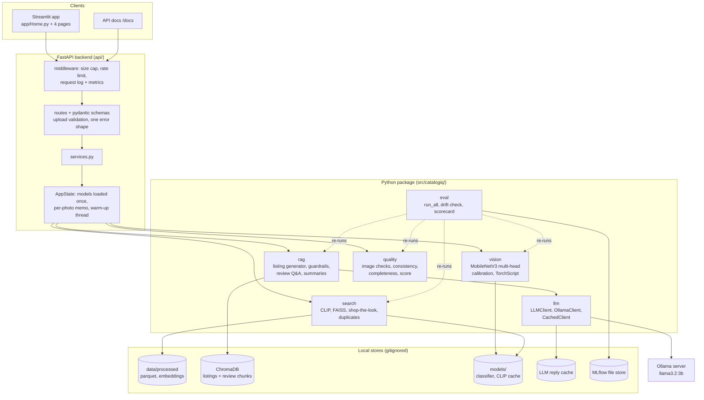
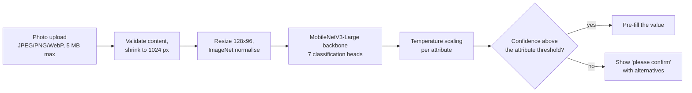
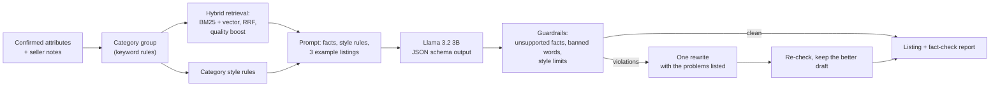
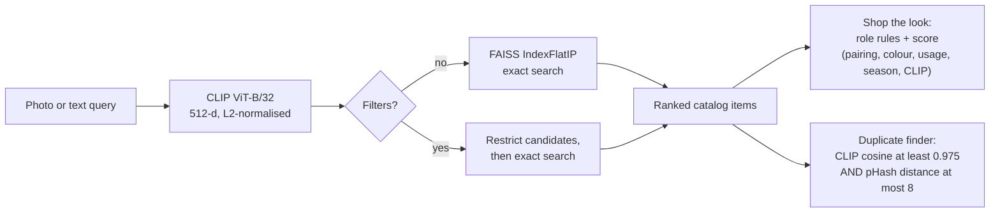
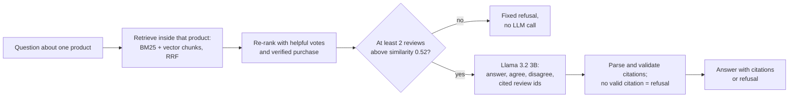
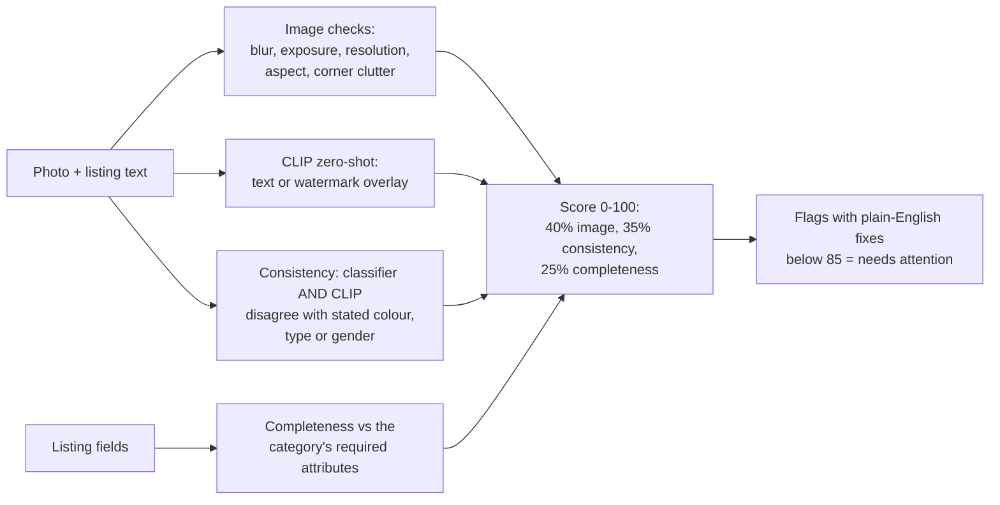

# Architecture

CatalogIQ is five models and indexes behind one API, plus an evaluation harness. Everything runs locally on CPU; the only
network use is the one-time download of data and pretrained weights. Numbers quoted here come from [the scorecard](../reports/scorecard.md)
or from [the decisions log](decisions.md), where the reasoning and the alternatives are recorded in full.

## Component diagram

**Design rules that shape the code**
- **Config-driven.** Paths, seeds, thresholds, limits and prompts live in `configs/` ([reference](configuration.md)); nothing is hard-coded.
- **One interface for the language model.** Everything calls `LLMClient.chat`; Ollama is one implementation and a hosted model would be another. A disk cache keyed by the full request makes evaluations repeatable and the demo instant.
- **Models load once, at startup**, into one `AppState`; services take that state, so tests can pass fakes (222 tests run without any model).
- **Fail clearly.** The server checks its required files at startup, answers `503 llm_unavailable` when Ollama is down, and the app explains what still works.

## Data flow per feature

### 1. Snap-to-Listing: photo to attributes

- Training data: 42,257 cleaned products, split by near-duplicate group (pHash distance at most 1) so twins never straddle train and test.
- Imbalance: square-root inverse-frequency class weights; classes under 100 photos dropped or merged; colour collapsed to 15 families.
- Two stages on CPU: heads only (4 epochs), then fine-tuning (6 epochs).
- Calibration: one temperature per attribute fitted on validation; the threshold is the lowest confidence at which accepted validation predictions are at least 90% right.
- Result: mean macro-F1 0.771, 13.9 ms per photo (scorecard section 1).

### 2. Grounded listing copy

- The knowledge base is 800 Amazon listings (a Bayesian-shrunk rating score picks exemplars) plus the style guide as 13 chunks, in ChromaDB.
- The hallucination check is deterministic: it compares the output with the attributes and seller notes only, using word lists in config. Retrieved examples are never a source of facts.
- Finding: with retrieved examples a 3B model copied facts from them, so 70.0% of listings contained an unsupported fact against 2.0% without examples; the rewrite brought the no-example arm to 0.0% (scorecard section 3). The app therefore defaults to the no-example pipeline plus rewrite and labels RAG with this warning.

### 3. Visual search, shop the look, duplicates

- All 42,257 catalog photos are embedded once (about 2 hours on CPU, chunked and resumable) and cached.
- Text queries are matched against image embeddings directly; the catalog-side text is an attribute sentence, never the product name.
- Results (scorecard section 2): Recall@10 0.890 for photo queries, 0.887 for text queries; vector search 23.0 ms and CLIP encoding 183 ms in the last run (both about 3x slower than first measured, flagged as drift, probably battery power).

### 4. Shopper Q&A over reviews

- 139,400 cleaned reviews become 166,607 chunks (whole if short, three-sentence windows if long).
- Results (scorecard section 4): Recall@5 1.000 and MRR 0.893 with the hybrid re-ranked retriever; 93.3% of unanswerable questions refused, 100% of cited ids exist; but 31.1% of answerable questions were refused too.
- The aspect summary (fit, fabric, colour, quality, comfort, delivery) computes every number in code; the LLM only phrases sentences, and a sentence with a number that is not in the facts is replaced by a template.

### 5. Catalog-quality checker

- Thresholds were tuned on the validation split with a rule fixed beforehand (highest recall while flagging at most 3% of clean photos); test photos were never used for tuning.
- Defects were created by degrading clean photos, because the catalog is nearly defect-free (2 of 120 natural photos).
- Results (scorecard section 5): blur recall 0.999 / precision 0.423, too dark 1.000 / 0.899, mismatch precision 0.472 / recall 0.477; 8.3% of the 6,339 test listings carry a flag.

### 6. Evaluation and scorecard

`python -m catalogiq.eval.run_all` re-runs each component on its fixed test set, logs every metric to MLflow (experiment `catalogiq-eval`, tagged with the git commit), compares 75 numbers with what the earlier phases recorded, measures end-to-end latency, RAM and disk, and writes `reports/scorecard.md`. LLM steps replay through the reply cache with a budget of cache misses, so a changed cache stops with a message instead of silently running for hours.

## Why each technology (and what was rejected)

| Choice | Over | Why (most rows are recorded in [decisions.md](decisions.md); ChromaDB, FastAPI and Streamlit are general reasons, not measured comparisons) |
|---|---|---|
| MobileNetV3-Large, own fine-tuning | EfficientNet-B0, ResNet-50 | 5.4M parameters and a 13 MB export, built for CPU, 18.7 ms per photo measured at the time. EfficientNet-B0 was not benchmarked, so the choice rests on published size and measured MobileNet speed. |
| 128x96 network input | 224x224 | The source photos are about 60x80 pixels; 224 only adds interpolation and about 3x compute. |
| Class weights ~ (1/count)^0.5 | Oversampling, full inverse frequency | The data has near-duplicate photos, so duplicating rare images encourages memorising them. |
| Hue augmentation disabled (the code raises if set) | Standard colour jitter | A hue shift would turn a navy shirt purple and corrupt the colour label. |
| Group-aware split on pHash groups | Random split | The same photo in train and test inflates accuracy. At pHash distance 2 the groups chained into one 2,859-image cluster, so the threshold is 1. |
| Temperature scaling + one threshold per attribute | Platt or isotonic calibration | One number per attribute is explainable; the models were already well calibrated. |
| TorchScript export | ONNX | Output identical to the eager model; the migration path to ONNX or `torch.export` is noted because `torch.jit` is deprecated. |
| OpenCLIP ViT-B/32, zero-shot | Fine-tuned CLIP, the Phase 2 features | CLIP beat the fine-tuned classifier's features on Recall@10 (0.890 against 0.854) with no training. |
| FAISS exact index (HNSW optional) | HNSW by default | At 42k items exact search is a few milliseconds with perfect recall; the 50 ms budget is crossed at about 400,000 items. |
| ChromaDB | A hosted vector database | Local, file-based, no server; fits the one-folder, CPU-only constraint. |
| In-house BM25 (about 50 lines) + RRF | `rank_bm25`, weighted score fusion | No new dependency; RRF needs no score calibration. Hybrid reached Recall@5 1.000 against 0.889 for vectors alone. |
| all-MiniLM-L6-v2 embeddings | bge-small, nomic-embed-text | Smallest and fastest on CPU for 800 short documents. |
| Llama 3.2 3B via Ollama behind `LLMClient` | A hosted API, a 7B model | Runs on CPU and locally; the interface lets a hosted model replace it. A 7B model (deepseek-r1:7b) was considered for the judge and rejected as slow; it was not tried as the writer. |
| Deterministic guardrails | An LLM fact checker | Explainable and testable; the LLM judge was the same 3B model and agreed poorly with the owner. |
| Evidence gate before the LLM call | Letting the model decide to refuse | The gate refuses without spending 40 s of CPU; tuned by product-grouped cross-validation because a dev/test split did not generalise. |
| OpenCV single-number image checks | A learned defect classifier | Simple, fast, explainable; thresholds come from one rule. CLIP zero-shot replaced the text heuristic because the heuristic found about 1% of overlaid text. |
| FastAPI | Flask | Pydantic schemas, validation and OpenAPI docs come with it. |
| Streamlit | A JavaScript front end | One language and the fastest way to a four-page product-style demo; the API stays the real product surface. |
| MLflow local file store | SQLite store, a hosted tracker | The brief asked for a local file store; SQLite is the noted migration path. |
| pytest with fixtures and mocks, GitHub Actions | Tests that need real models | CI has no data or weights, so the 75.5% coverage figure is measured the way CI sees it. |

## Where the limits are

See [limitations and risks](limitations_and_risks.md) and the scorecard (section 9) for dataset bias, label noise, small-LLM limits and what would change at production scale.
